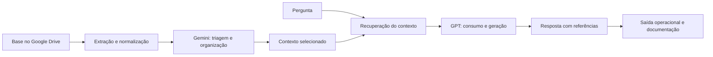

# MVP de automação com LLM

Na operação, muita informação já existe, mas fica espalhada em documentos, páginas, anotações e históricos. Antes de responder uma dúvida ou tratar um incidente, gasto tempo encontrando e organizando tudo.

A ideia do MVP foi juntar esse contexto e gerar uma resposta útil, com as fontes usadas. Primeiro validar o fluxo, os limites e o custo. A plataforma completa podia esperar.

## O que o MVP buscava resolver

- localizar informações em fontes diferentes sem fazer a mesma busca várias vezes;
- reunir o contexto antes da análise do modelo;
- padronizar respostas sem esconder de onde a informação veio;
- apoiar documentação e triagem técnica;
- reduzir trabalho manual em tarefas repetitivas;
- controlar custo, volume processado e dependência de serviços externos.

## Como organizei a solução

Separei o fluxo em três partes:

1. **Origem dos dados:** documentos e conteúdos textuais escolhidos para a consulta.
2. **Processamento:** extração e normalização, triagem do conteúdo com o Gemini e preparação do contexto.
3. **Saída operacional:** resposta organizada, referências utilizadas e material que pode voltar para a documentação.

O **Gemini fez a triagem e organizou o conteúdo**. O **GPT recebeu o contexto selecionado e gerou a resposta**. Cada um tinha uma função no fluxo.

Assim fica mais fácil trocar uma fonte ou modelo e encontrar a falha: na origem, na preparação, na busca ou na resposta.

## O que decidimos não fazer nesta etapa

### Processamento de vídeos

Vídeo ficou fora dessa etapa. Teria que transcrever áudio, tratar duração, idioma, ruído, falantes e marcações de tempo. Em alguns casos, também analisar o que aparece na tela.

Isso aumentaria custo, processamento, armazenamento e pontos de falha. Começamos por texto. Se a fonte for vídeo, nesta fase entra uma transcrição revisada, com link e marcações de tempo.

### Integração direta com o NotebookLM

Usei o NotebookLM como referência para consulta baseada em fontes. A integração direta ficou fora do núcleo do MVP.

Quando avaliamos a integração pessoal, não havia um caminho oficial e estável que atendesse ao fluxo. A análise registrada também considerou as APIs do **Gemini Notebook Enterprise**, então em preview, com projeto no Google Cloud, permissões e licenciamento próprios. Isso aumentaria o escopo e o custo; a disponibilidade precisa ser conferida de novo antes de retomar essa opção.

O NotebookLM ficou para comparação manual e estudo. Se uma integração fizer sentido depois, pode entrar como adaptador, sem refazer o restante.

## Princípios adotados

- começar pequeno e medir antes de aumentar o escopo;
- manter fonte, processamento e saída separados;
- responder somente com o contexto recuperado;
- mostrar as referências usadas;
- admitir quando o material não é suficiente;
- evitar enviar dados sensíveis sem necessidade;
- limitar tamanho, quantidade de chamadas e custo por execução;
- registrar erros e decisões para aprender com os testes.

## O que conseguimos validar

Aplicamos o MVP no Google Cloud, com a base organizada no Google Drive funcionando como fonte. Validamos o caminho entre entrada, triagem no Gemini, contexto para o GPT e resposta operacional.

Construí o MVP com [Edmundo Neto](https://github.com/emal0n). Ele contribuiu com desenvolvimento, backend, mobile, boas práticas de código, documentação e produto. Minha parte ficou principalmente em infraestrutura, cloud, SRE, automação, observabilidade e custo. A ideia era conseguir desenvolver e manter o que estávamos propondo.

Este repositório documenta o raciocínio e as decisões. Ele não publica dados internos, credenciais, bases privadas ou conteúdo usado apenas durante experimentos.

## Arquivos privados de trabalho

As fontes, configurações e instruções de uso ficam no [repositório privado projetos-llms](https://github.com/BaianoMaligno/projetos-llms/tree/main/projetos/mvp-automacao-llm/originais/Estudos_IA). Este repositório público contém a documentação do MVP e exemplos que não expõem dados pessoais.

## Documentação

- [Arquitetura](docs/arquitetura.md)
- [Decisões do projeto](docs/decisoes.md)
- [Escopo e limitações](docs/escopo-e-limitacoes.md)
- [Próximos passos](docs/proximos-passos.md)
- [Segurança e privacidade](SECURITY.md)

## Tecnologias e serviços usados

O MVP foi aplicado no Google Cloud e utilizou uma base organizada no Google Drive. O desenho manteve uma camada para ingestão e orquestração, preparação dos documentos e metadados, triagem com o Gemini, recuperação do contexto e consumo pelo GPT.

O principal resultado foi testar o fluxo completo e os critérios da resposta. As ferramentas entraram conforme a necessidade de cada etapa.

## Resultado esperado

Quero uma resposta curta, útil e que dê para conferir. Se a fonte não responder à pergunta, o sistema precisa dizer isso. Parecer certo sem ter apoio no material continua sendo erro.

